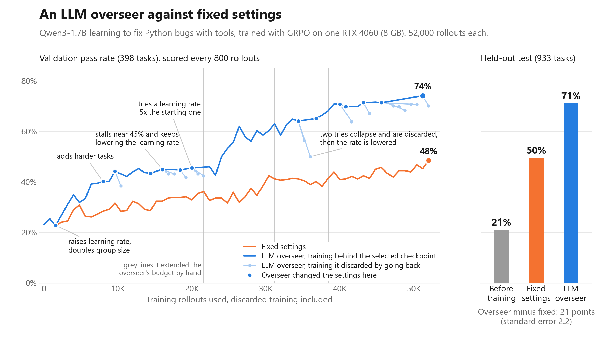

# An LLM overseer for long RL runs on a small coding model

This repository reports a proof-of-concept experiment in which a large language model manages a long reinforcement learning (RL) run. A small model, Qwen3-1.7B, learns through RL to repair bugs in Python functions with tool calls, while a large model, Claude Fable 5.2, reviews the metrics after every evaluation and chooses the training settings for the next stretch. I compare this overseer run against a baseline that trains with fixed settings for the same 52,000 rollouts. Both runs were carried out on a single RTX 4060 with 8 GB of memory.

The solid blue line follows the training that led to the overseer run's selected checkpoint. The faint stubs show training that the overseer discarded by returning to an earlier checkpoint, and those rollouts still count against its budget.

## Result

Both runs used 52,000 training rollouts. For each run, the final checkpoint was selected on validation and then scored once on a held-out test set of 933 tasks. The test tasks are built from 213 functions that appear in neither the training data nor the validation data.

| Model | Test tasks solved | Share | Standard error |
|---|---|---|---|
| Qwen3-1.7B before training | 197 of 933 | 21.1% | 2.2 points |
| Trained with fixed settings | 463 of 933 | 49.6% | 2.9 points |
| Trained with the LLM overseer | 663 of 933 | 71.1% | 2.8 points |

The overseer run solved 200 more test tasks than the fixed-settings run, a difference of 21.4 percentage points with a paired standard error of 2.2 points. Each arm was run once, so this difference rests on a single pair of runs. The [Limitations](#limitations) section lists what the comparison leaves open.

## Background

The experiment builds on two papers. ProRL ([Liu et al., 2025](https://arxiv.org/abs/2505.24864)) showed that RL on a language model continues to pay off when the run is much longer than usual, provided the run is managed along the way. Their method controls KL divergence, resets the reference policy when progress stalls, and trains on a wide set of tasks. The resulting models solved problems that the base model failed however many attempts it was given.

LLMZero ([Fang et al., 2026](https://arxiv.org/abs/2606.18388), [code](https://github.com/amazon-science/LLMZero)) handed that management to an LLM. It treats a training run as a tree of phases, in which an LLM agent reads the metrics at each checkpoint, works out what is going wrong, and proposes the settings for the next phase. On four GRPO tasks it improved on grid search by 6% to 15% (relative) and beat both random search and a skill-based agent at equal compute. The authors also found that a weak overseer did worse than no overseer at all.

Taken together, the two papers suggest using an LLM as the optimizer of a long RL run. LLMZero spent thousands of A100-hours per task and did not test coding or multi-turn tasks, so I wanted to know whether the idea carries over to multi-turn coding with tools. The small scale of this experiment was set by my hardware. With one 8 GB card, the policy model is limited to 1.7B parameters and the tasks to short bug fixes.

The design departs from LLMZero in four ways. First, the overseer follows a single line of training where LLMZero searches a tree, because the budget here does not cover many branches. After every evaluation it continues, starts a new phase with new settings, or returns to an earlier checkpoint. Second, the overseer keeps a journal. It writes a prediction with every decision, grades that prediction at the next evaluation, and reads its own earlier entries in each new prompt. Third, in addition to the usual training settings, the overseer can change the share of hard tasks in the training data. Fourth, the baseline is matched to the overseer run. It trains with the starting settings for the same number of rollouts, under the same evaluation schedule and the same rule for selecting the final checkpoint.

## Method

### Task

Each task is a Python function from MBPP with one seeded bug. The model has up to 10 tool calls, with which it can view the file, edit it, run the visible tests and submit. A task counts as solved only if the submitted file passes every hidden test. The training, validation and test tasks are built from three separate sets of functions.

### Training

The policy is trained with GRPO on a LoRA adapter, using Unsloth for training and vLLM for sampling inside WSL2. Code written by the model runs in a sandbox. The training reward gives partial credit, capped at 0.5, to a submission that passes some of the hidden tests, whereas validation and test scoring is pass or fail. The run can be saved and resumed at any point, which was necessary because it shared the machine with daily use.

### Overseer

Every 800 rollouts the run pauses and the current checkpoint is scored on 398 validation tasks. Claude Fable 5.2 then receives a text table of training and validation metrics together with its own journal. It has no tools and never sees test data. It returns one of three decisions.

| Decision | Effect |
|---|---|
| `CONTINUE` | Training goes on with the same settings. |
| `NEW_PHASE` | Training goes on from the current checkpoint with new settings. |
| `REVERT` | Training restarts from an earlier checkpoint, with the same or new settings. |

The overseer can set the learning rate, the group size, the rollouts per update, the sampling temperature, the gradient clip, the reward scaling, the completion length, the share of hard tasks, and whether the optimizer state is kept. Rollouts spent on training that is later discarded still count against the budget.

### Baseline

The baseline keeps the starting settings (learning rate 2e-5, group size 4, no hard tasks) for all 52,000 rollouts. It shares its first 1,600 rollouts with the overseer run.

### Checkpoint selection and testing

For both runs, the selected checkpoint is the evaluation with the best mean validation pass rate over itself and the two evaluations before it. The test set is read once for each selected checkpoint. Standard errors are clustered by function, because tasks built from the same function are not independent.

## What the overseer did

The overseer made 65 decisions, of which 43 continued, 6 started a new phase and 16 reverted to an earlier checkpoint. All 65 calls returned a valid decision, and together they cost $58.52. Of the 52,000 rollouts, 38,400 lie on the line of training that led to the selected checkpoint, and the other 13,600 went into training that the overseer later discarded.

The first gains came early. After two evaluations without progress, the overseer raised the learning rate from 2e-5 to 5e-5 and doubled the group size, and validation rose from 23% to 40% by 8,000 rollouts. It then introduced tasks that the base model had never solved, first as 25% of the training data and later as 50%.

A long stall followed, during which validation stayed between 42% and 46% for 14 evaluations. The overseer had been told that the budget was 24,000 rollouts, and as that limit approached it kept lowering the learning rate to protect what it had, down to 1e-6. When I extended the budget, its next decision noted that it had been planning as if few evaluations remained. It returned to the checkpoint from two evaluations earlier and set the learning rate to 1e-4, five times the starting value. Validation then climbed from 45% to 64%.

That rate did not stay stable. The next evaluation fell to 56%, and a second attempt from the 64% checkpoint fell to 50%. The overseer discarded both, restarted from the 64% checkpoint with a lower rate, and reached 71%. Over the last 17 evaluations, validation stayed between 64% and 74%, with a mean of 70%, whatever the overseer tried.

Every decision, with the overseer's reason, prediction and self-grade, is in [DECISIONS.md](DECISIONS.md).

## Limitations

The result comes from one run of each arm, and the points below limit what it supports.

### Sample size

I ran the overseer once and the baseline once, so the spread between runs is not measured.

### Strength of the baseline

The baseline may be weaker than a well-tuned fixed recipe. Its learning rate was the best one from an earlier, smaller search, while the overseer's largest gain came from a rate five times higher, which I never ran as a fixed setting. The overseer could also add hard tasks to the training data, whereas the baseline trained on the easy pool only. In addition, the baseline was still improving when it stopped, since its best evaluation was its last one.

There is also no random-search arm, so I cannot say that the gain requires an LLM. Any reasonable schedule of changes might capture much of it, and LLMZero's random search came close to the full method on one of its tasks.

### Budget and compute

I extended the budget by hand during the run. It started at 24,000 rollouts, I raised it three times, and I stopped the run at 52,000. At 24,000 rollouts, the selection rule would have chosen checkpoints at about 46% (overseer) and 35% (baseline) on validation, as three-evaluation means.

The two arms are matched on rollouts, and their GPU time is unequal. The overseer run took 96.5 GPU-hours and the baseline 78.2, because the overseer's model made more tool calls per rollout.

### Changes during the run

The plan named Claude Opus 5.5 as the overseer, and the run used Claude Fable 5.2. Late in the run I widened the allowed range for the hard-task share, although the training behind the selected checkpoint never used the wider values. At call 45 I also fixed a bug in how the journal is shortened for the prompt.

### Selection on validation

Validation scores favour the overseer slightly, because it saw them at every step and its checkpoint is selected on them. Its selected checkpoint scored 74.1% on validation and 71.1% on test, while the baseline's scored 48.5% and 49.6%.

### Scope

The task is narrow. It covers short single-function bug fixes, a 1.7B model and one 8 GB card. The overseer-trained model also has a quirk. After it submits, it repeats the submit call until the turn limit. The environment ignores every submit after the first, so the scores are unaffected, but a later version should end the episode at the first submit.

## Did it reach the model's limit?

I do not know. Over the last 17 evaluations, 187 of the 398 validation tasks passed every time, 67 never passed, and the remaining 144 flipped between pass and fail. If every task that ever passed had passed every time, validation would be 83%. By that stage most training groups carried no learning signal, because the model solved the task either on every attempt or on none. The first plateau, however, looked just as final until a larger learning rate broke it. Fresh or harder tasks are the first thing I would try.

## Conclusion

I wanted to know whether an LLM overseer for a long RL run carries over to multi-turn coding with tools. In this one comparison it did. At the same 52,000 rollouts, the overseer run solved 71.1% of the held-out test tasks and the fixed-settings run solved 49.6%.

Both runs also kept improving past the first budget of 24,000 rollouts, which agrees with ProRL's finding about long runs. From that point to the selected checkpoint, validation went from about 46% to 74.1% for the overseer run and from about 35% to 48.5% for the baseline.

The experiment does not show where the overseer's gain comes from. Its largest single gain followed one change, the higher learning rate, and a fixed run at that rate or a random schedule of changes might recover much of it. Answering that question takes several seeds per arm, a fixed baseline at the higher rate, a random-search arm, and one budget that is set before the run.

## What is in this repo

The repository holds the code of the run reported here. It is a snapshot of research code and is not packaged for reuse.

| Path | Contents |
|---|---|
| `figures/results.png` | The chart above. |
| `DECISIONS.md` | All 65 overseer decisions with their reasons. |
| `results/` | `evals.json` (every validation evaluation of both runs, the selected checkpoints, the test results), `journal.jsonl` (the overseer's raw log), and the scripts that build the chart and the decision log. |
| `run/` | The orchestrator, the overseer prompts, the trainer, the task sampler and the allowed settings. `final_test.py` does the single test read. |
| `env/` | The task: generator, tools, grader and sandbox. |
| `eval/` | Validation and test scoring. |
| `configs/` | The config file the run started from, and a small one for smoke tests. |
| `data/` | Task-id lists: the easy pool (`train_pool.txt`), the hard pool, validation and test. |
| `scripts/` | Machine setup, and the watchdogs for GPU memory and host RAM. |
| `tests/` | Tests of the orchestrator with a fake trainer and a fake overseer, and a CPU dry run of the trainer. |
| `requirements.txt` | Exact package versions of the training environment. |

Notes for readers:

- After the run I moved the files into this layout and updated the paths. The orchestrator tests pass on it. I have not repeated a GPU run since the move.
- Home paths were replaced before publishing (`/home/user`), and the working directory was renamed to match the repo.
- Checkpoints, rollout logs and the task files are not included. `env/tasks.py` rebuilds the tasks from MBPP and MBPP+.
- The code expects WSL2, an 8 GB NVIDIA card and its working files under `~/llm-overseer-rl`. The task lists in `configs/` are given relative to the repo, and `tasks_dir` points into the working directory.
- Run `python results/plot.py` to redraw the chart from `results/evals.json`.

## Credits

- [ProRL](https://arxiv.org/abs/2505.24864) and [LLMZero](https://arxiv.org/abs/2606.18388) for the idea.
- Tasks are built from [MBPP](https://github.com/google-research/google-research/tree/master/mbpp) (CC BY 4.0) and MBPP+ from [EvalPlus](https://github.com/evalplus/evalplus) (Apache 2.0).
- Training uses [Unsloth](https://github.com/unslothai/unsloth), [TRL](https://github.com/huggingface/trl) and [vLLM](https://github.com/vllm-project/vllm).

## Licence

MIT. See [LICENSE](LICENSE).
